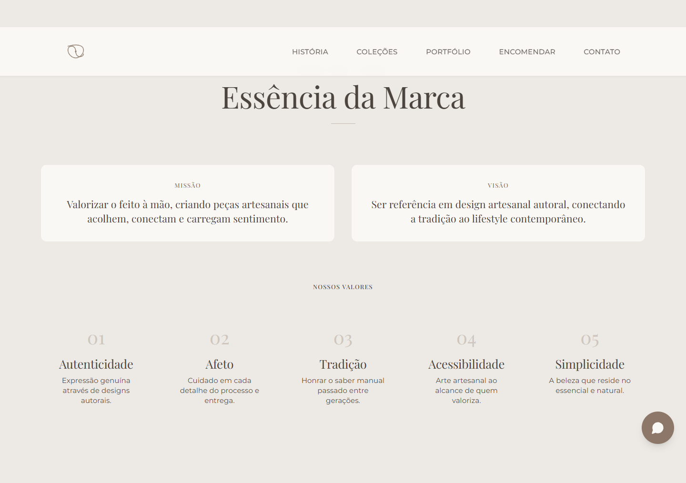
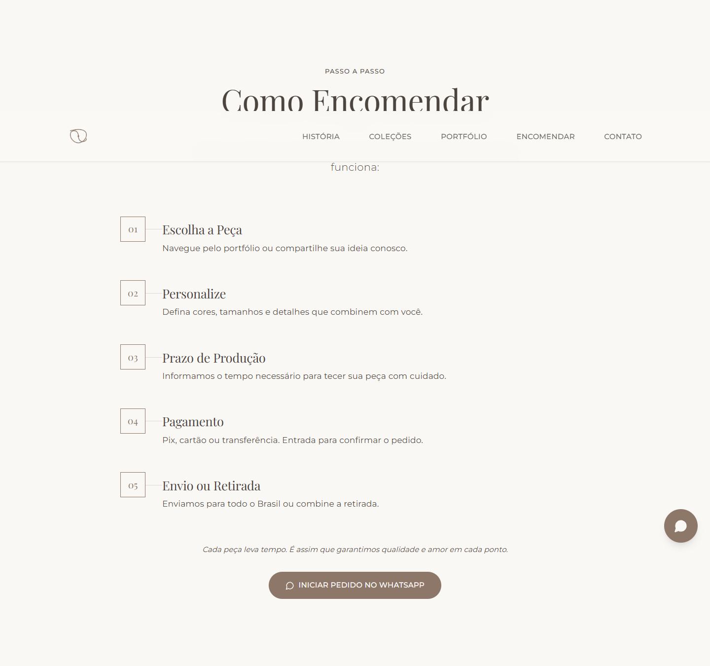
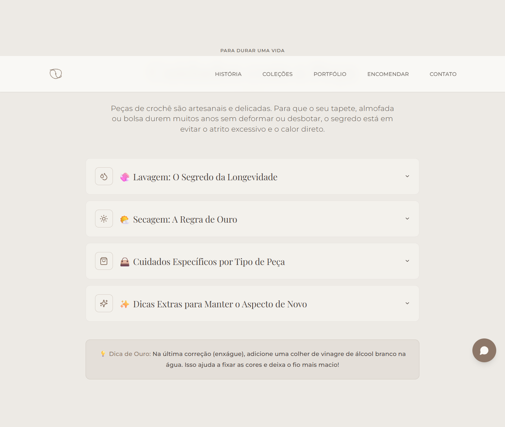
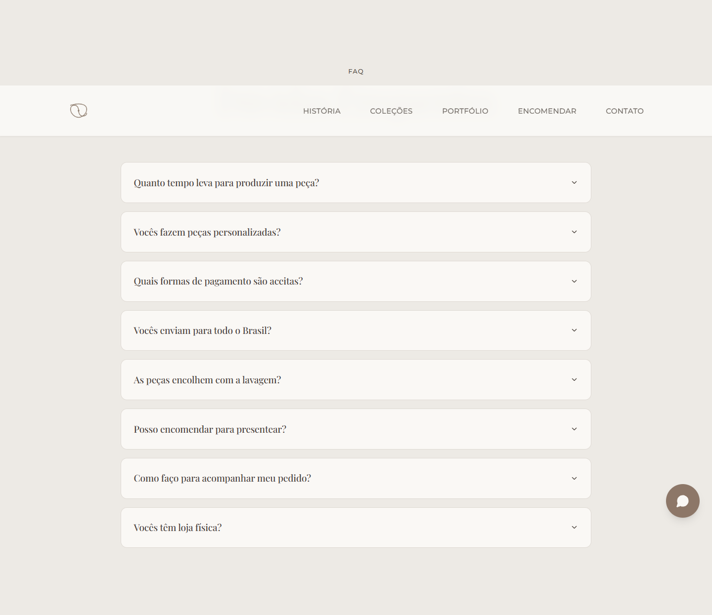

#  Tenua — Vitrine Digital (Projeto de Portfólio)

> **ℹ️ Projeto de portfólio.** A Tenua é uma marca **fictícia**, criada para demonstrar na prática como eu desenvolvo uma vitrine digital completa — do design ao deploy. Não se trata de um cliente real.

---

## 🎯 O desafio (cenário fictício)

Imaginei um ateliê de peças artesanais (bolsas, mantas e tapetes) que vende apenas pelo WhatsApp e Instagram, sem um catálogo organizado nem uma presença de marca à altura do seu posicionamento "premium/artesanal".

**A proposta:** uma aplicação web rápida que funcione como:
1.  **Catálogo vivo:** apresentação dos produtos por coleção.
2.  **Experiência de marca:** comunicar os valores do ateliê (feito à mão, tempo, dedicação).
3.  **Funil de conversão:** levar o visitante interessado direto para o WhatsApp comercial.

---

## 🏗️ Arquitetura e decisões técnicas

### Frontend (SPA)
*   **React 18 + TypeScript:** tipagem estrita para reduzir bugs em tempo de execução.
*   **Vite:** build rápido e HMR (Hot Module Replacement) durante o desenvolvimento.
*   **Tailwind CSS + shadcn/ui:** padronização visual com tokens (cores, espaçamentos) definidos no Figma.
*   **TanStack Query:** gerenciamento de estado de servidor, separando a camada de dados da interface.

### Infraestrutura & CI/CD
*   **Hospedagem:** Vercel.
*   **CI:** GitHub Actions roda `npm ci`, `npm run lint` e `npm run build` a cada push/PR na `main`.
*   **Monitoramento:** workflow de uptime no GitHub Actions.

---

## ⚙️ Como rodar localmente

### Pré-requisitos
*   **Node.js** `v18` ou superior
*   **npm**

### Variáveis de ambiente (opcional)
Crie um arquivo `.env` na raiz, se quiser personalizar:
```env
VITE_API_URL=http://localhost:3000
VITE_WHATSAPP_NUMBER=55 99 9999-9999
```
⚠️ Nunca faça commit de chaves de API ou segredos.

### Instalação e execução
```bash
npm ci        # instala as dependências
npm run dev   # inicia o servidor local
```

O projeto fica disponível em: `http://localhost:8080`

---

## 🤖 Scripts

| Comando | Função |
| :--- | :--- |
| `npm run dev` | Inicia o servidor de desenvolvimento |
| `npm run build` | Gera o build de produção (`/dist`) |
| `npm run preview` | Testa o build de produção localmente |
| `npm run lint` | Roda o ESLint |
| `npm run backup` | Cria um snapshot local do projeto em `backups/<timestamp>/` |

---

## 📸 Galeria da aplicação

### 🏠 Home & Hero


### 🧶 História & Essência
| História | Essência |
| :---: | :---: |
|  |  |

### 👜 Coleções


### 🖼️ Portfólio


### 📦 Encomendas


### ℹ️ Suporte
| Cuidados | FAQ |
| :---: | :---: |
|  |  |

### 📞 Contato


---

## 🛡️ Qualidade e monitoramento

### CI de qualidade
*   Workflow `.github/workflows/ci.yml`: roda `npm ci`, `npm run lint` e `npm run build` em push/PR para `main` (Node 18).

### Monitoramento de uptime
*   Workflow `.github/workflows/uptime-monitor.yml`: verifica a disponibilidade do site a cada 15 minutos.
*   Requer a variável `SITE_URL` em **Repository Variables**.
*   Em caso de falha, abre uma Issue com o status HTTP e o horário.

### Healthcheck
*   Arquivo estático `public/healthcheck.json`, acessível em `/healthcheck.json`, para monitores externos.

### Backups
*   `npm run backup` copia `src/`, `public/` e configs para `backups/<timestamp>/`, com um `manifest.json` listando o conteúdo e a data.

---

## 👨‍💻 Autor

Projeto idealizado, desenhado e desenvolvido por **Zacarias Ramos** — design (Figma), frontend e configuração de CI/CD.

[LinkedIn](https://www.linkedin.com/in/zacariaslino/) · [GitHub](https://github.com/lino167)
